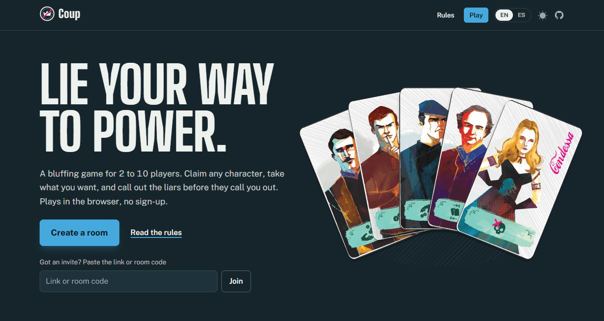
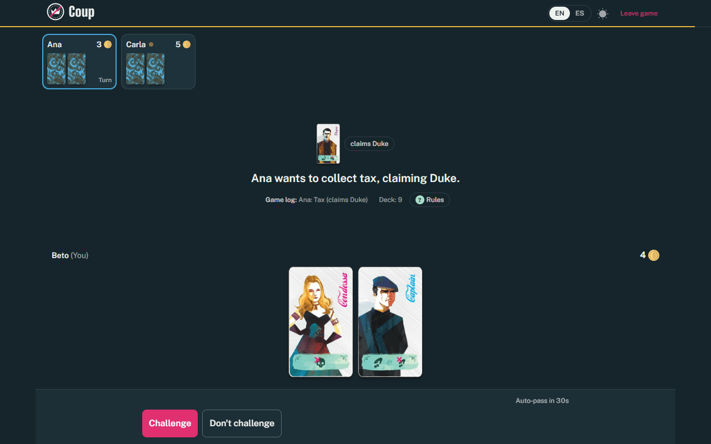
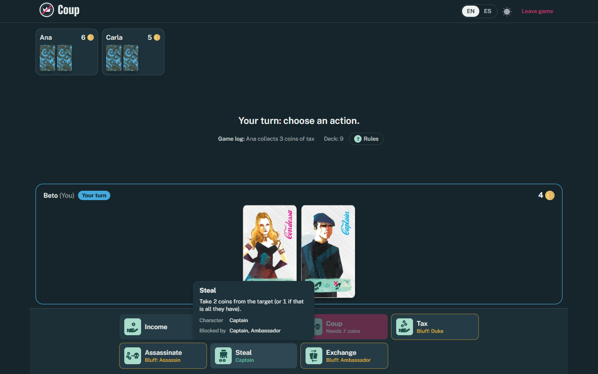
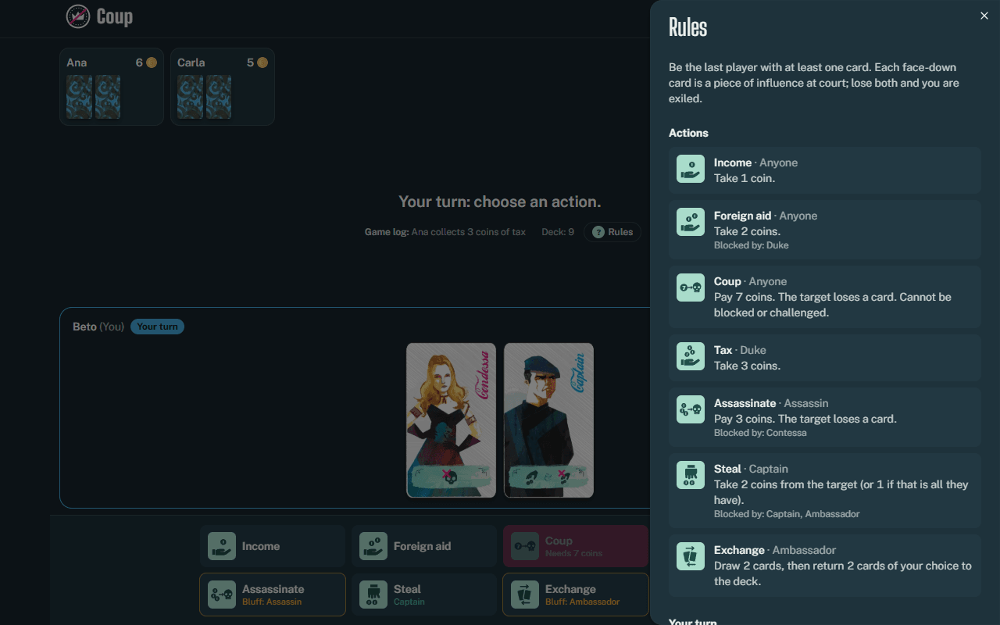
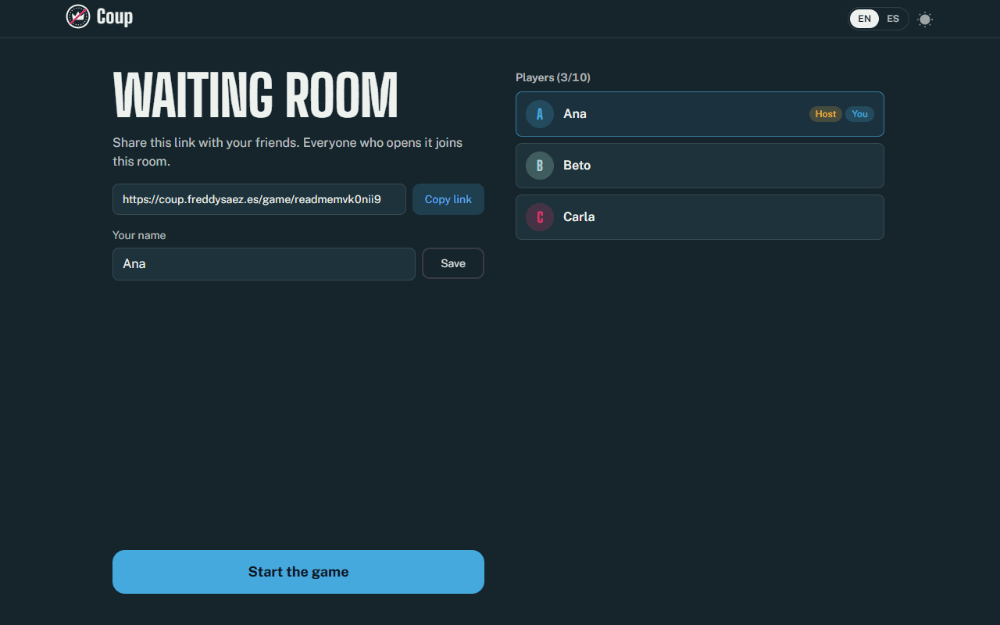
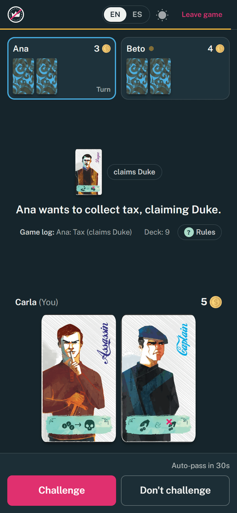
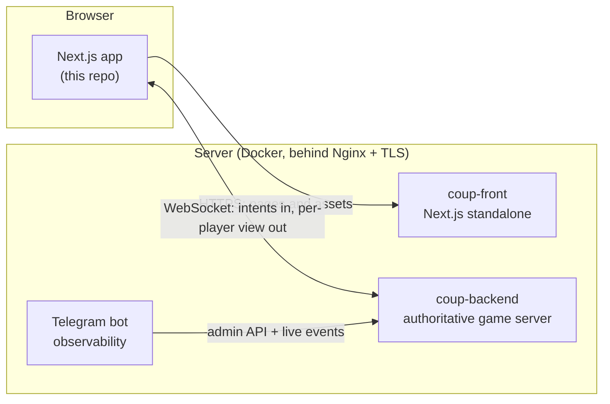

<div align="center">


# Coup

**The bluffing card game, online. Lie your way to power with 2 to 10 friends, right in the browser.**

[**▶ Play now at coup.freddysaez.es**](https://coup.freddysaez.es)

[](https://github.com/freddysae0/coup/actions/workflows/cicd.yml)    [](LICENSE)



</div>

---

Coup is a game of deception: everyone holds two face-down characters, and you
may claim to be **any** of them. Take what you want, and call out the liars
before they call you out. This repository is the web client. The rules run on
an authoritative WebSocket server: [**coup-backend**](https://github.com/freddysae0/coup-backend).

## Features

- **Rooms are links.** Create a room, share the URL and start when everyone is
  in. No accounts, no sign-up.
- **Cheat-proof by design.** The server deals and validates every move; the
  browser only ever receives your own cards.
- **Pick up where you left off.** Refresh, lose the connection or close the tab
  and open the link again: you are back in your seat with the same cards. Two
  tabs on one computer are still two players, so you can test a full game alone.
- **Readable at a glance.** Each action has its own icon, drawn in the style of
  the card art. Hover one to see what it does, who it needs and who can block it.
- **Rules at hand.** A rules panel opens mid-game without leaving the table, and
  the full rules have their own page.
- **Every screen size.** Phones, tablets and desktops, in light and dark mode.
- **English and Spanish,** switchable at any time.

## Screenshots

<p align="center">
  <br />
  <sub>Ana claims the Duke to collect tax. Everyone else has 30 seconds to challenge her or let it happen.</sub>
</p>

<table>
  <tr>
    <td width="50%" valign="top">
      <br />
      <sub>Every action has its own icon. Hover for what it does and who can block it; a bluff is flagged in amber.</sub>
    </td>
    <td width="50%" valign="top">
      <br />
      <sub>The rules are one click away, without leaving the table.</sub>
    </td>
  </tr>
</table>

<table>
  <tr>
    <td width="64%" valign="top">
      <br />
      <sub>The waiting room: share the link, pick a name, and the host starts the game.</sub>
    </td>
    <td width="36%" valign="top">
      <br />
      <sub>Built for phones too.</sub>
    </td>
  </tr>
</table>

## How a game goes

1. **Gather.** The host creates a room and shares the link. Up to 10 players join.
2. **Declare.** On your turn you take one action. Character actions only
   require that you *say* you hold that character.
3. **Challenge.** Anyone who doubts a claim can challenge it. Whoever is wrong
   loses a card.
4. **Block.** Some actions can be stopped by claiming the right character, and
   blocks can be challenged too.
5. **Survive.** Lose both cards and you are out. The last player standing wins
   the court.

| Character | Action | Blocks |
| --- | --- | --- |
| Duke | Tax: take 3 coins | Foreign aid |
| Assassin | Pay 3 coins: a player loses a card | — |
| Captain | Steal 2 coins from a player | Stealing |
| Ambassador | Draw 2 cards, keep the ones you want | Stealing |
| Contessa | — | Assassination |

Anyone can also take **Income** (1 coin), **Foreign aid** (2 coins) or launch a
**Coup** (pay 7 coins, a player loses a card; mandatory at 10 coins). The full
rules, edge cases included, are at [coup.freddysaez.es/rules](https://coup.freddysaez.es/rules).

## Architecture



The client is deliberately thin: it sends **intents** (`action`, `challenge`,
`block`, `pass`, `loseCard`, `exchange`) and renders the **view** the server
sends back. That view includes `options`, the exact list of things this player
can do right now, so the UI never re-implements the rules.

## Tech stack

| | |
| --- | --- |
| Framework | [Next.js 15](https://nextjs.org) (App Router), React 18, TypeScript |
| UI | [HeroUI](https://www.heroui.com), Tailwind CSS, Framer Motion |
| Real time | Native WebSocket with automatic reconnection (`shared/useCoupSocket.ts`) |
| Tests | Vitest + Testing Library |
| Delivery | Docker (Next.js `standalone`), GitHub Actions, Ploi |

## Getting started

You need Node.js 22 and the [backend](https://github.com/freddysae0/coup-backend)
running locally.

```bash
# 1. Backend, in another terminal (listens on ws://localhost:8000)
git clone https://github.com/freddysae0/coup-backend.git
cd coup-backend && npm install && npm run dev

# 2. Frontend (http://localhost:3000)
git clone https://github.com/freddysae0/coup.git
cd coup && npm install && npm run dev
```

Open a room in several tabs to play against yourself.

The WebSocket URL is chosen in the browser: on plain HTTP the client connects to
`ws://<host>:8000`, so localhost, your LAN IP or a bare server IP all work. Set
`NEXT_PUBLIC_WS_URL` at build time to point it somewhere else, as production
does with `wss://coup-back.freddysaez.es`.

| Script | What it does |
| --- | --- |
| `npm run dev` | Development server with Turbopack |
| `npm run build` / `npm start` | Production build and server |
| `npm run lint` | ESLint (with `--fix`) |
| `npm test` | Unit tests with Vitest |

## Project structure

```
app/
├── (site)/                  Landing page and /rules
├── game/[...slug]/          A room: /game/<room-id>
│   ├── page.tsx             Connection, errors and lobby or game switch
│   └── components/
│       ├── Lobby/           Invite link, nickname, start
│       ├── RunningGame/     Table, hand, action dock, log and rules drawers
│       └── TopBar.tsx       Leave button and response countdown
├── opengraph-image.tsx      Share card for link previews
shared/
├── useCoupSocket.ts         WebSocket, reconnection and seat claiming
├── icons/ActionIcon.tsx     The action icons (inline SVG)
├── components/              GameCard, ActionBadge, Navbar, Footer…
└── gameMeta.ts              Action costs, roles and blockers
i18n/                        English and Spanish dictionaries
types/game.ts                Protocol types shared with the backend
```

## Deployment

Production runs at <https://coup.freddysaez.es> on a [Ploi](https://ploi.io)
server, next to the backend. Every push to `master` runs lint, tests and a
production build on GitHub Actions; if they pass, Ploi checks out **that exact
commit** and runs `docker compose up -d --build`. Nginx terminates TLS and
proxies to the container on `127.0.0.1:3000`.

<details>
<summary>One-time server setup</summary>

1. Create the site `coup.freddysaez.es` in Ploi, install this repository on the
   `master` branch and add a Let's Encrypt certificate. Leave **Quick deploy off**.
2. Create `.env` in the site directory from `.env.example`. It only holds
   `NEXT_PUBLIC_WS_URL`, which is baked into the bundle at build time.
3. Deploy script:

   ```bash
   set -e
   cd /home/ploi/coup.freddysaez.es
   git fetch origin master
   TARGET="${SHA:-origin/master}"
   git merge-base --is-ancestor "$TARGET" origin/master
   git checkout --force --detach "$TARGET"
   docker compose up -d --build --remove-orphans
   docker image prune -f
   echo "Deployed $(git rev-parse --short HEAD)"
   ```

4. Nginx: replace the PHP `location` blocks with a proxy to the container:

   ```nginx
   location / {
       proxy_pass http://127.0.0.1:3000;
       proxy_http_version 1.1;
       proxy_set_header Host $host;
       proxy_set_header X-Real-IP $remote_addr;
       proxy_set_header X-Forwarded-For $proxy_add_x_forwarded_for;
       proxy_set_header X-Forwarded-Proto $scheme;
   }
   ```

   Do not add a `/.well-known/acme-challenge/` location: Ploi already includes
   one, and a duplicate makes `nginx -t` fail.

5. Copy the deploy webhook URL from the site's *Repository* tab into the GitHub
   secret `PLOI_DEPLOY_WEBHOOK`.

</details>

## Contributing

Issues and pull requests are welcome. Before opening a PR, run
`npm run lint && npm test`. CI also runs a production build, so `npm run build`
is worth a try for larger changes.

## Credits

Coup was designed by **Rikki Tahta** and is published by **Indie Boards & Cards**.
This is an unofficial, non-commercial fan adaptation, made by
[Freddy Sáez](https://github.com/freddysae0)
([LinkedIn](https://www.linkedin.com/in/freddy-js/)).
